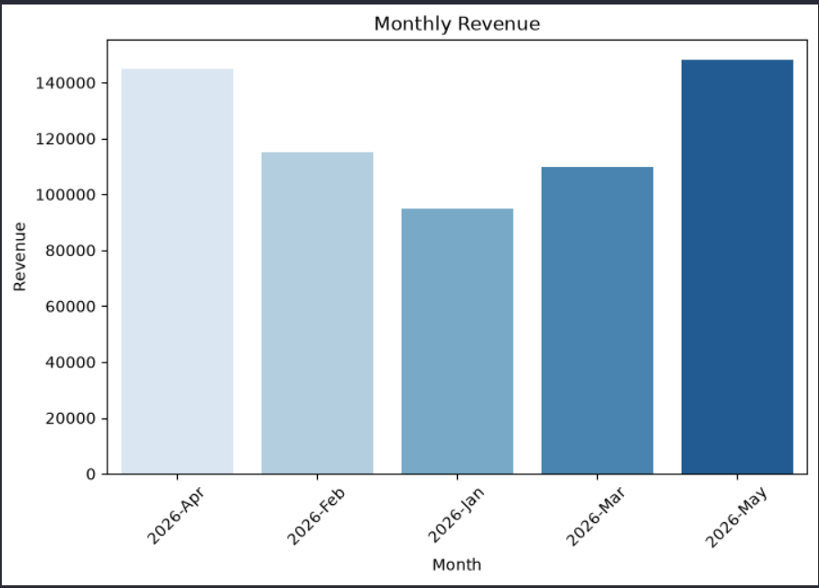
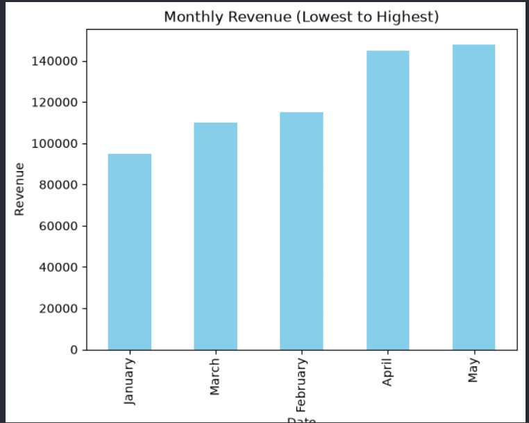
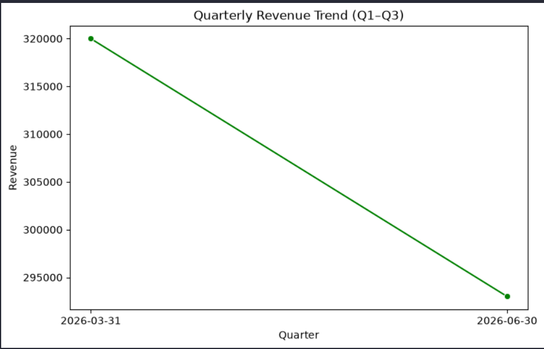
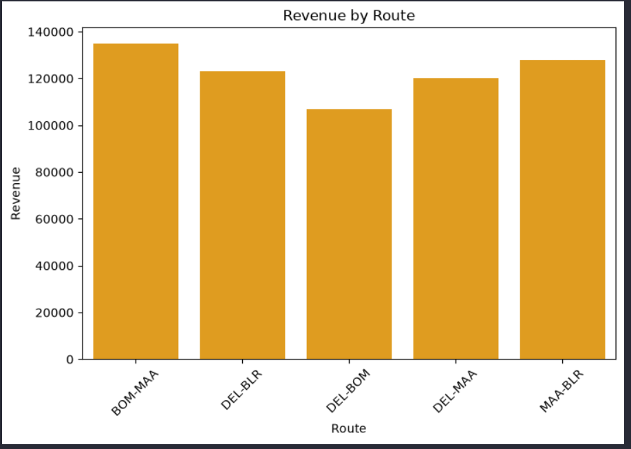
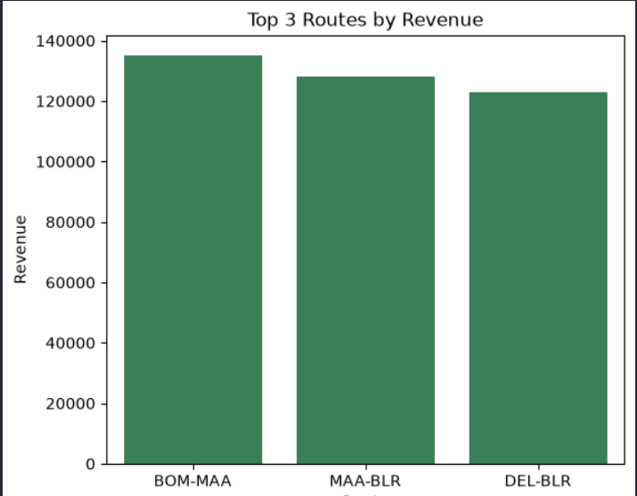
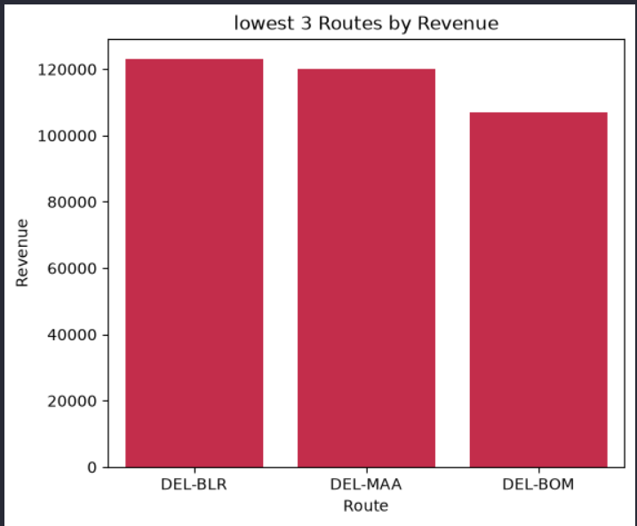
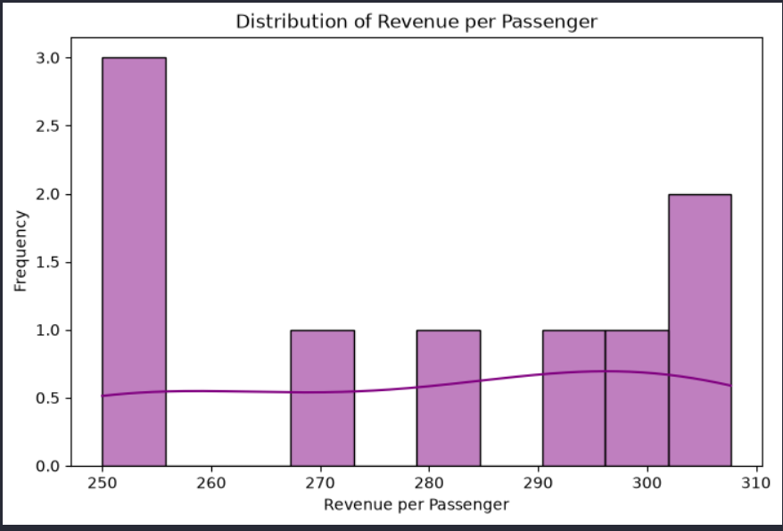

# Airline Sales Insights ✈️
Python Mini Project 1 // Airline Sales

## Objective
Analyze airline sales data to identify top revenue-contributing routes and understand sales distribution patterns.

## Folder Structure
├── Data/               # raw datasets (CSV, Excel)
├── Notebooks/          # Jupyter notebooks or Python scripts
├── Visuals/            # charts and graphs (PNG, JPG)
├── README.md           # project documentation
└── Requirements.txt    # list of Python libraries (optional)

## Methodology
1. Group sales data by route.
2. Calculate total revenue per route.
3. Compute % contribution of each route.
4. Visualize top routes using pie/bar charts.

## Visuals

### Monthly Revenue

### Monthly Revenue (Lowest vs Highest)

### Quarterly Revenue Trend

### Revenue by Route

### Top 3 Routes by Revenue

### Lowest 3 Routes by Revenue

### Distribution of Revenue per Passenger

## Visual Summary (3-Word Insights + Explanation)

| Visualization                        | Key Insight (3 words)       | Explanation                                                                 |
|--------------------------------------|-----------------------------|-----------------------------------------------------------------------------|
| Monthly Revenue                      | Peak vs Low                 | May recorded the highest (~145k), while January was the lowest (~95k).      |
| Monthly Revenue (Lowest vs Highest)  | Seasonal Demand Gap         | Clear gap between peak and trough months highlights seasonality in demand.  |
| Quarterly Revenue Trend              | Growth then Stabilization   | Q2 shows strong growth momentum, while Q3 stabilizes.                       |
| Revenue by Route                     | BLR Route Dominates         | Bengaluru (BLR) route contributes the most revenue, Kochi (COK) lags.       |
| Top 3 Routes                         | High Route Dependence       | Heavy reliance on top routes drives overall performance.                    |
| Lowest 3 Routes                      | Weak Route Contribution     | Weak routes contribute minimally, suggesting optimization or reconsideration.|
| Revenue Distribution per Passenger   | Uneven Yield Spread         | Revenue is unevenly distributed, with a small group of passengers yielding more. |

## Insights
- May recorded the highest monthly revenue (~145k), while January was the lowest (~95k).
- The route to Bengaluru (BLR) is the strongest contributor, whereas the route to Kochi (COK) shows weaker performance.
- Heavy reliance on top routes indicates potential risk if demand shifts.

## Recommendations

- **Diversify Routes:** Reduce dependency on Bengaluru (BLR) by strengthening secondary routes and exploring new markets.  
- **Boost Weak Performers:** Reassess low‑revenue routes (e.g., Kochi) for pricing, promotions, or possible restructuring.  
- **Plan for Seasonality:** Anticipate demand fluctuations by adjusting capacity and marketing during low‑revenue months.  
- **Enhance Passenger Yield:** Target high‑yield passenger segments with loyalty programs and premium services.  
- **Quarterly Monitoring:** Maintain close tracking of quarterly trends to respond quickly to growth or stabilization phases.  
- **Revenue Optimization:** Use data‑driven pricing strategies to maximize contribution across all routes.  

## Tech Stack
- Python (Pandas, Matplotlib)
- Jupyter Notebook
- GitHub for version control
